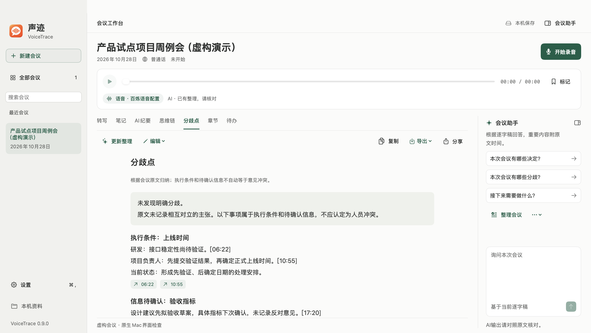

# VoiceTrace · 声迹

**A native macOS AI meeting workspace: keep the discussion, clarify the differences.**

[简体中文](README.md) · [MIT License](LICENSE) · [Security & privacy](SECURITY.md) · [0.9.0 changelog](CHANGELOG.md)


## Overview

VoiceTrace is a SwiftUI application that combines cloud speech recognition and language models to turn meetings into transcripts, notes, summaries, discussion chains, disagreement analysis, chapters, and action items. It is designed for reading, checking sources, and replaying important passages.

This is a self-build testing release. Not every provider or supported macOS version has been validated end to end.

## Features

- Live microphone recording and transcription, pause/resume/finish, local audio files, and timestamp playback.
- Concurrent draft summaries, discussion chains, disagreements, chapters, and actions; separate controls for periodic and end-of-recording processing.
- Bounded source chunks, cached intermediate summaries, hierarchical merging, and reuse of completed work after a failed request.
- Transcript corrections, speaker-label updates, protected manual edits, AI suggestion comparison, and revision restoration.
- Searchable meeting table, rename context menu, multi-select deletion, Recently Deleted recovery, and confirmed permanent deletion.
- User-triggered local recovery of unregistered PCM recordings, preserving source files without automatic uploads.
- Optional post-meeting transcription and speaker diarization. Speaker identities across recording segments require review.
- Seven sections: Transcript, Notes, AI Summary, Discussion Chain, Disagreements, Chapters, and Actions.
- **Discussion Chain** structures participants' topics, positions, stated reasons, responses, and conclusions. It is not the model's private chain of thought.
- **Disagreements** distinguishes explicit opposing positions from execution constraints and unresolved information, with source timestamps. It should not invent conflict when none is stated.
- Transcript-grounded questions and configurable model profiles.
- Copy, DOCX/PDF/TXT/Markdown export, a discussion-chain PNG, and macOS sharing.
- Four visual themes, consistent controls and forms, an assistant sheet in compact windows, actual microphone levels, and reduced-motion support.



## Clean release and privacy

**No author's API keys, Workspace IDs, private profiles, real recordings, or meeting documents are included.** Bring your own provider accounts and credentials; provider charges apply.

- API keys are stored in macOS Keychain and cached in process memory after a successful read. They are not written to source files, preferences, or logs.
- This clean release uses a separate application and Keychain namespace. It does not load the personal edition's credentials, preferences, or meeting directory.
- Meeting files are stored under `~/Documents/VoiceTrace`; non-secret profiles are stored in application preferences. Meeting files are not additionally encrypted.
- Recognition is not fully offline. Starting transcription sends audio to the configured speech provider; summaries and questions send text to the configured language-model provider.
- **Periodic summaries (every 30 seconds) and final summaries are enabled by default.** Switch them off independently in Settings → Recording & Summaries before recording if desired. Manual processing remains available. No summary request is made without a configured text-provider key.
- Summary caches, suggestions, revisions, and recordings/text in Recently Deleted are also stored locally. Moving a meeting to Recently Deleted is not permanent deletion.
- Messages are not automatically sent to WeChat, DingTalk, or any contact. The user chooses recipients and confirms sharing.
- Screenshots, bundled demos, and tests use fictional data.

## Requirements and build

- macOS 13 or later.
- Xcode Command Line Tools with Swift and a macOS SDK.
- No local language model or third-party Swift package is required.
- Python 3 is also needed for tests and the publishing audit.

From the repository root:

```sh
./测试.command
./构建.command
```

The build creates an Apple Silicon / Intel universal app and applies an ad-hoc local signature:

```text
outputs/声迹 VoiceTrace Clean.app
outputs/VoiceTrace-Mac-0.9.0-Clean.zip
```

Open the app after extracting it or dragging it to Applications. This is not a notarized Developer ID distribution. Configure a stable signing identity and Apple notarization for wider distribution. macOS may require launch approval and microphone permission.

## Provider setup

Open **Settings → Models & Services** and configure speech and text profiles separately.

| Purpose | Currently adapted interfaces |
|---|---|
| Live speech | Alibaba Cloud Model Studio Fun-ASR-Realtime and its versioned models |
| Post-meeting speech / speakers | `fun-asr`, `paraformer-v2`, `qwen-audio-3.0-asr-flash-filetrans` |
| Speech regions | Beijing and Singapore; region, Workspace ID, and key must match |
| Summaries and questions | Official DeepSeek or an HTTPS Chat Completions-compatible endpoint |

Model availability, permissions, and fees depend on the provider account. The speech connection test checks the task handshake only; the text test sends fixed fictional text. Neither replaces a complete recording test.

Typical flow: configure providers and automatic processing → create a meeting → record and read live drafts → finish → review/correct text and compare AI suggestions → export/share.

The Edit menu offers protected edits, suggestion comparison, revision history, and per-chunk summaries. Transcript paragraphs can be corrected individually. Post-meeting recognition does not directly overwrite manually corrected transcripts; restore an earlier revision first if needed.

All Meetings supports checkboxes and Command/Shift selection. Deletion moves records to Recently Deleted first; permanent deletion requires confirmation. See the [native design system](docs/DESIGN.md).


## Limitations

- Captures the default microphone, not system audio.
- A network interruption stops the current segment; automatic reconnection and retransmission are not implemented.
- Post-meeting recognition uses the provider's temporary development/testing upload storage. Replace it for production use.
- Post-meeting upload is limited to two hours and 300 MB per segment. Speaker IDs are not aligned across segments.
- Ad-hoc signatures do not guarantee persistent Keychain authorization across app updates.
- Chunk summaries and the merged overview can omit details. Check the original transcript, recordings, and per-chunk results.
- Long-meeting questions use an overview and matching source excerpts, with an explicit limited-scope notice; they are not exhaustive full-text searches.
- Four-hour synthetic timelines do not establish four-hour recording reliability. Simulated network/device events and interrupted writers do not replace live provider and Bluetooth tests.
- AI output can be wrong. Review important conclusions, sources, and action items.
- Compatible endpoints and model response formats require testing.

## Development and publishing checks

```sh
# Inspect staged files without printing matched secret values
python3 scripts/audit.py --staged

# Enable the repository-local pre-commit audit
git config core.hooksPath .githooks
```

Tests cover the protocol, old meeting formats, summary fields, timestamps, profile isolation, credential caching, exports, section routing, chunk caching, revision protection, deletion/recovery, fault events, save ordering, and theme contrast. They do not use real credentials, microphones, or cloud calls. The audit is heuristic and does not replace manual review.

## License and contributions

Project source and original repository assets are licensed under the [MIT License](LICENSE). Provider terms and Apple platform/SDK terms apply separately; see [third-party notices](THIRD_PARTY_NOTICES.md). Issues and pull requests are welcome. Never include real credentials or private meeting material in contributions.
