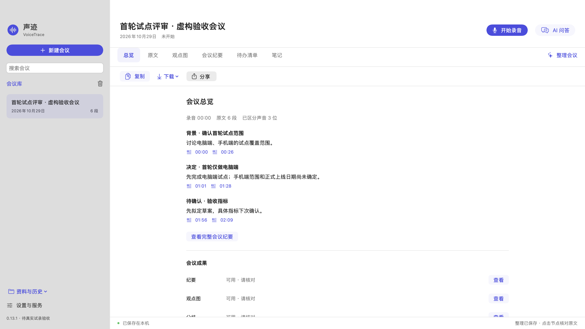
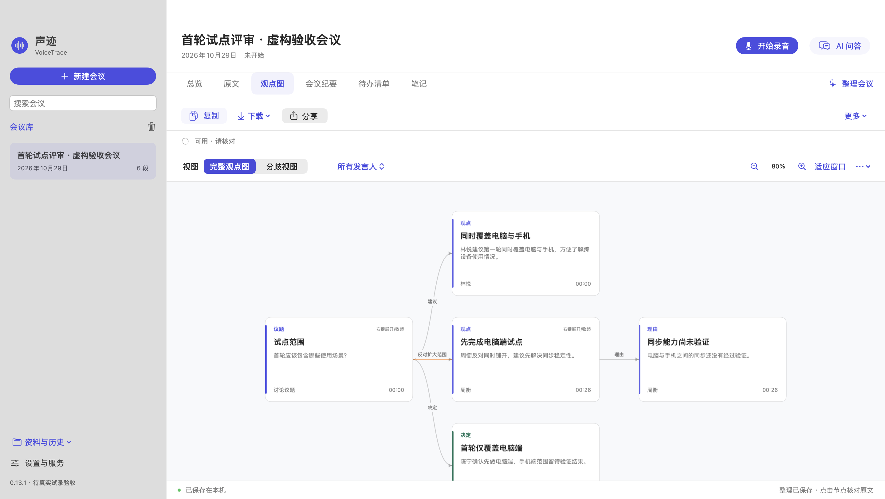
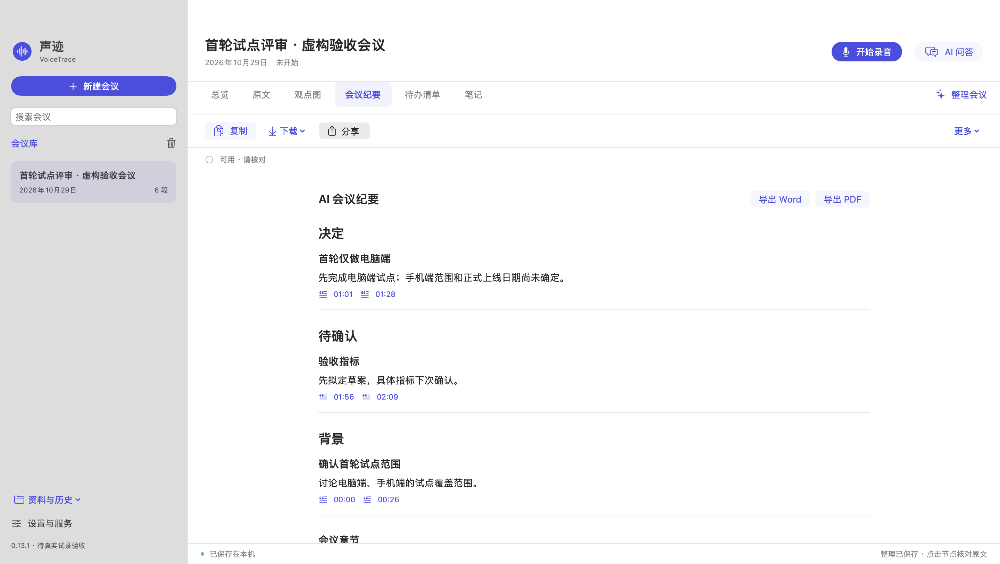
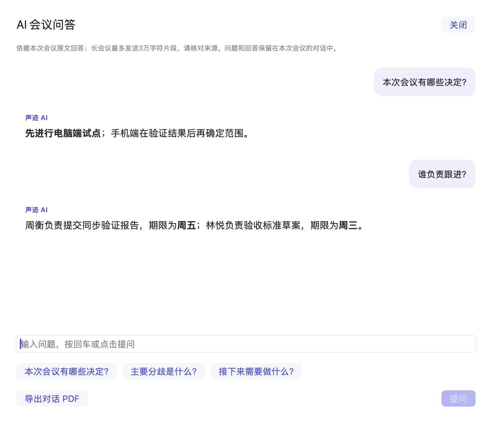
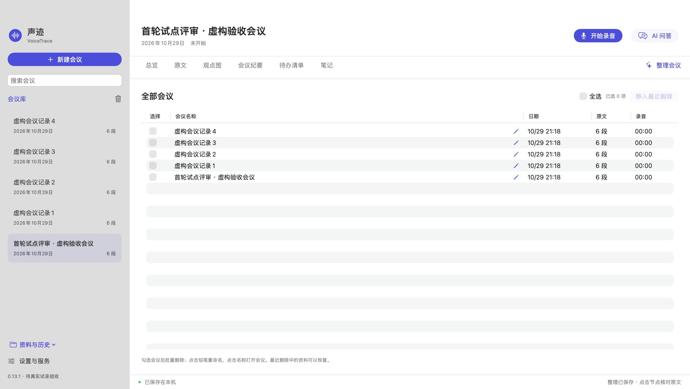
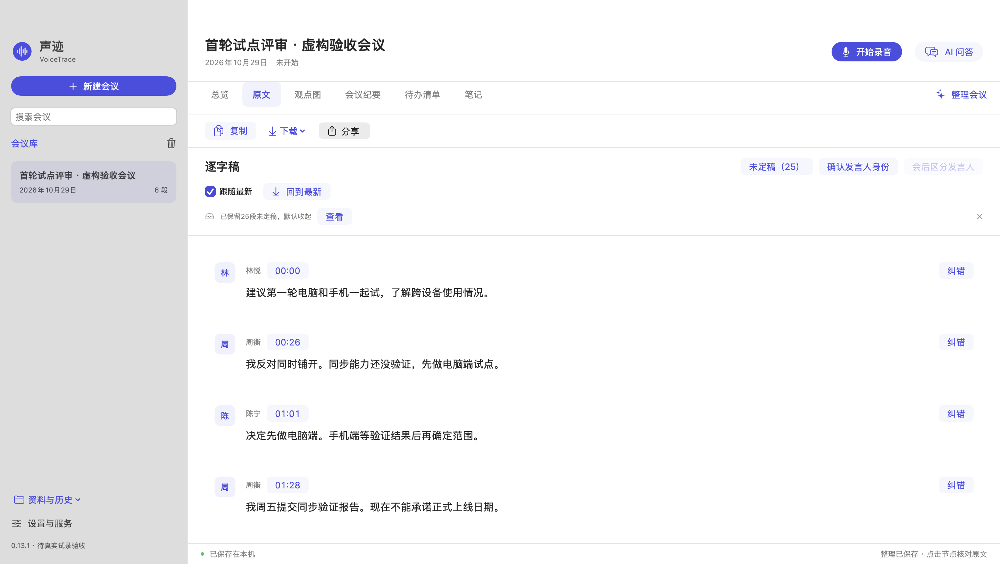

# VoiceTrace · 声迹

**A native macOS AI meeting workspace: record, transcribe, review source-linked minutes and opinion graphs.**

[简体中文](README.md) · [MIT License](LICENSE) · [Changelog](CHANGELOG.md) · [Security & privacy](SECURITY.md)



## Overview

VoiceTrace uses SwiftUI, AppKit and system audio APIs. Meeting data stays in a local library; live Mandarin recognition and meeting analysis use cloud APIs configured by the user. No local language model is required.

The current release is **0.13.1, a testing release**, for Intel and Apple Silicon Macs. The public source and clean build contain no author's API keys, Workspace IDs, private profiles or real meeting data. All screenshots and test inputs are fictional.

## Features

- **Recording and live transcript:** start, pause, resume and finish; local audio, playback, input levels, waveform, recognition state and last-result age. Local capture starts before asynchronous credential loading and speech connection.
- **Speakers:** distinguishable voices receive numbered placeholders that users can rename consistently. Unknown identities remain unknown; cross-segment identities require review.
- **Meeting outputs:** Overview, Transcript, Opinion Graph, Meeting Minutes, To-do List and Notes. Chapters link to transcript times; positions, decisions and tasks reference source passages.
- **Actual graphs:** typed nodes, directed edges and relationship labels, zoom, fit, speaker/disagreement filters and branch collapse. Select a node for its full content and sources.
- **Minutes and tasks:** structured groups distinguish decisions, proposals and unresolved information. Missing owners/deadlines remain explicitly unconfirmed; completion state is saved.
- **Analysis and conversation:** independently switch periodic and final analysis on or off. Continuous questions and answers are stored with the meeting; submitting immediately clears the composer.
- **Meeting library:** search, rename, explicit checkboxes, Select All, bulk move to Recently Deleted and restore.
- **Copy, download and share:** persistent controls on the main pages; Word / PDF / Markdown / TXT for text and PNG / SVG for graphs. Choose a service in the macOS share picker, or download and attach the file in WeChat or DingTalk.
- **Recovery and diagnostics:** bounded speech reconnection while local recording continues; collapsed and dismissible unfinished-draft notices without deleting text; interrupted recording recovery and content-free startup diagnostics.







## Build and use

Requires **macOS 13+, Xcode Command Line Tools and Python 3**. No third-party Swift packages, network fonts or web runtime are required.

From the repository root:

```sh
# Offline tests: no real keys, microphone access or cloud requests
./测试.command

# Universal Intel / Apple Silicon clean build by default
./构建.command
```

Outputs:

```text
outputs/VoiceTrace-0.13.1-clean/声迹VoiceTrace Clean.app
outputs/VoiceTrace-0.13.1-clean.zip
```

Extract the app and place it in Applications. Builds use an ad-hoc local signature and are **not Developer ID notarized**. macOS may require launch and microphone approval. Persistent Keychain authorization across updates is not guaranteed.

The current app lives in [`Next/`](Next/README.md). The default build excludes the legacy workbench UI. Selected protocol, configuration, credentials, service and audio files in `Sources/` are shared; other legacy code and tests remain for compatibility reference.

### Provider setup

Open VoiceTrace Settings and configure speech and text profiles separately using your own region, Workspace ID, endpoint, model and API key. Never put real credentials in source code or Git.

| Purpose | Adapted interfaces |
| --- | --- |
| Live speech | Alibaba Cloud Model Studio Fun-ASR-Realtime and versioned variants; Beijing / Singapore |
| Post-meeting transcription | `fun-asr`, `paraformer-v2`, `qwen-audio-3.0-asr-flash-filetrans` |
| Meeting analysis and questions | Official DeepSeek or HTTPS Chat Completions-compatible endpoints; multiple saved profiles |

Availability, permissions and fees depend on the provider. Speech currently supports the Alibaba protocol only; **Doubao is not yet integrated**. Changing a model name alone does not change protocols. Speech and text may use the same provider only when both interfaces are supported.

Flow: configure → create meeting → record → finish → review sources, speakers and outputs → download/share. Use Follow Latest or Jump to Latest for long transcripts. Data & History can copy legacy meetings into the new library while preserving originals.





## Privacy and data boundaries

- Keys are stored in macOS Keychain and cached in process memory after reading. They are not embedded in app bundles or diagnostics. The clean edition uses independent preferences and Keychain accounts and does not load the personal edition's keys or library.
- The clean library is under `~/Library/Application Support/VoiceTrace Next`. This internal directory name is retained for compatibility. Audio, transcripts, revisions, conversations and caches are **not additionally encrypted**.
- Local capture writes to disk first. Enabled live recognition sends audio to the selected speech provider. Analysis and questions send relevant transcript text and necessary context to the configured text provider.
- **Periodic analysis (checked every 45 seconds) and final analysis are enabled by default**, independently configurable in Settings. No text-service request is made without its key. Manual analysis remains available when automatic processing is off.
- Startup diagnostics contain up to 32 whitelisted phases, relative milliseconds and numeric error codes, written in the background. They exclude audio, transcripts, questions and keys.
- Unfinished drafts are excluded from the confirmed transcript and meeting-analysis input. Dismissing the notice preserves their text. Recently Deleted retains local data; no automatic permanent purge is performed.
- The app never automatically sends files to contacts. Sharing destination and sending remain under user control.

See [Security & privacy](SECURITY.md).

## Validation and limitations

Offline core tests, simulated recording/speech and workspace flows, synthetic PCM conversion, reopened Word/PDF content checks, universal builds and signature checks have passed. Screenshots come from isolated clean instances parsing fictional provider responses, saving and reopening the results; **they do not demonstrate live cloud recognition**.

- Captures the default microphone, not system audio.
- Speech retries up to three times automatically, with manual reconnection available, while local recording continues. Missing passages require manual post-meeting transcription; there is no automatic backfill.
- Post-meeting speech depends on provider temporary-upload capability; the two-hour / 300 MB per-segment limit and cross-segment speaker review still apply.
- Questions currently use at most 30,000 characters of source excerpts and are not exhaustive full-text searches. AI may omit or misinterpret details. Review important decisions, citations and tasks against the source.
- Physical microphones, Bluetooth/headphone changes, long recordings, cloud latency and content quality still need device/provider trials. Simulations do not establish those results or constitute independent certification.

See [acceptance evidence](Next/docs/ACCEPTANCE.md) and [interface notes](docs/DESIGN.md).

## Development and contributions

```sh
./Next/test.command
./Next/test-workspace.command
./Next/test-audio.command
./Next/test-export.command

# Audit staged content without printing matched secrets
python3 scripts/audit.py --staged
```

Local data, credentials, builds and test outputs are excluded from Git. The audit is heuristic and still requires human review. Issues and pull requests are welcome; use fictional or redacted materials only.

Source and original assets use the [MIT License](LICENSE). Provider and Apple platform terms apply separately; see [third-party notices](THIRD_PARTY_NOTICES.md).
